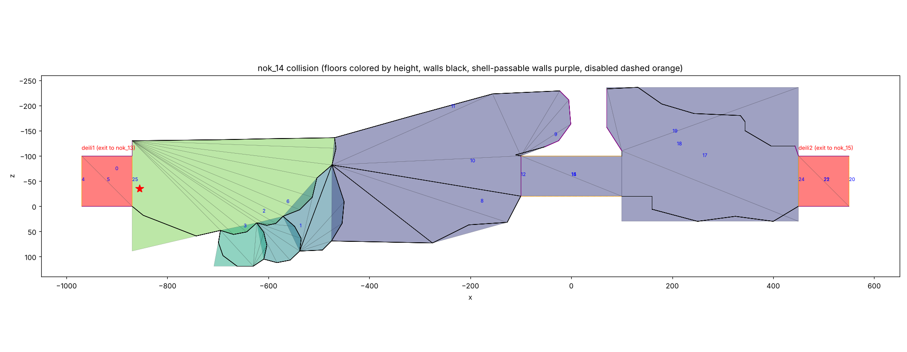
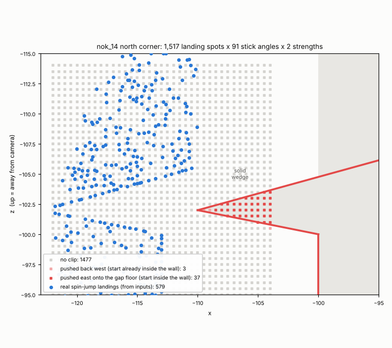

# Kooper skip bot (Paper Mario, JP 1.0)

A bot that searches for out-of-bounds routes in **nok_14** (Pleasant Path, "Path to Fortress 1"): get from the left loading zone to the right one without hitting the switch that raises the bridge, using loading zone storage (LZS) jumps.

It runs the real game in a headless mupen64plus, reads Mario's state from RAM using addresses from the [pmret/papermario](https://github.com/pmret/papermario) decomp, and tries jump sequences many times faster than real time.

No ROM or savestates are included. You need your own *Mario Story* (J) ROM. The decomp's JP baserom has SHA-1 `b9cca3ff260b9ff427d981626b82f96de73586d3`.

## The room



Collision read from RAM after the room loads (`dump_collision.py`, `draw_map.py`). The camera looks toward −z, so the top of the image is the back of the room.

| collider | what it is |
|---|---|
| 5 `deili1` | left exit floor (to nok_13), x −970…−870, y 75 |
| 21 `deili2` | right exit floor (to nok_15), x 450…550, y 0 |
| 4, 20 `deilit`, `deilit2` | walls behind each exit, disabled on load (`COLLIDER_FLAGS_UPPER_MASK`) |
| 12 | wall at x=−100 that stops Mario reaching the unbuilt bridge. Kooper's shell passes through it (`IGNORE_SHELL`). |
| 14 | floor across the bridge gap, x −100…100, y 0 |

Every wall in the room is vertical and every floor is flat. So an out-of-bounds route can only use pieces of floor that extend past the walls, which several do.

## How loading zone storage works (from the decomp, confirmed in the emulator)

1. Both exits are `TRIGGER_FLOOR_ABOVE` triggers (`src/trigger.c`). They fire as soon as the floor under Mario's shadow (`gCollisionStatus.floorBelow`) is the exit collider, even in midair. The trigger starts `EVT_EXIT_WALK_NOK`.
2. That script first calls `UseExitHeading` (`src/evt/player_api.c`). It blocks until `can_trigger_loading_zone()` (`src/7BB60.c`) is true, which needs Mario's action state to be idle, walk, run, tweester or spin. Until then the exit is **stored**.
3. Each frame, `step_game_loop` runs scripts *before* the player update. So the exit fires on the first frame that **starts** with Mario grounded.
4. Landing:
   - **Stick held:** `player_handle_floor_collider_type` goes straight to walk/run and the frame ends grounded, so the exit fires on the next frame.
   - **Stick neutral:** the landing frame ends in `ACTION_STATE_LAND`, which doesn't count as grounded.
5. On the next frame, the LAND update falls through to idle. `phys_update_action_state` runs the idle update in the same frame (its `do … while (ACTION_STATE_CHANGED)` loop), and idle checks for a jump. Pressing A on that frame makes Mario jump without ever ending a frame grounded, so the exit stays stored.

So each LZS jump needs a **neutral stick on the landing frame** and **A on the next frame**. The JP game reads input one game frame late, so with the inputs as sent to the emulator, A goes on the frame after the one where Mario is first seen in LAND.

If Mario walks or falls off the collision, the cubic gravity integrator eventually flips sign and launches him upward, and the game puts him back at his last landing spot. The stored exit survives this.

## How the bot works

- **`harness.c` + `emu.py`:** a mupen64plus core driven one rendered frame at a time from Python. Savestates are synchronous and uncompressed, and RDRAM is read directly. The game renders twice per game frame, so the bot always steps two callbacks at a time. `harness.c` doubles as the input plugin.
- **`mupen64plus-core-headless.patch`:** two changes to mupen64plus-core (commit `ba95bab`):
  - raise the RDP "frame done" interrupt itself, since no video plugin runs and the game would otherwise wait forever
  - make savestates synchronous and uncompressed
- **`make_state.py`:** boots, starts a new file, and redirects its first map load to nok_14 entry 0 with story progress set to "arrived at Koopa Village". It then saves `states/nok14_start.st`.
- **`lzs.py`:** the LZS jump primitive. From a "ready" state (Mario just landed with the exit stored), it jumps with a stick direction and an A-hold length. It runs once to find the landing frame, then replays with a neutral stick on that frame. The result is a new ready state, `exit` (the stored exit fired), or `void` (Mario never landed).
- **`explore.py`:** a Go-Explore search over ready states, using 4 worker processes.
  - **Cells:** (floor collider, x/12, z/12, y/30).
  - **Each try:** pick a cell (weighted toward ones tried less often) and try a random jump. There are 32 stick angles, 3 stick strengths and 6 A-hold lengths, plus a jump in place.
  - **Archive:** any landing in a new cell is kept, with the shortest input path that reached it. States are stored as XOR diffs against the first ready state, about 136KB each.
  - **Goal:** the floor below Mario becomes `deili2` (collider 21) while the nok_13 exit is still stored.

## Running it

```sh
# 1. build mupen64plus-core with the patch
git clone https://github.com/mupen64plus/mupen64plus-core && cd mupen64plus-core
git checkout ba95bab && git apply ../mupen64plus-core-headless.patch
make -C projects/unix all NETPLAY=0 OSD=0 NEW_DYNAREC=1 && cd ..
# 2. build the harness (needs mupen64plus-rsp-hle, e.g. from the distro's mupen64plus packages)
gcc -O2 -shared -fPIC -o harness.so harness.c -Imupen64plus-core/src/api -ldl -lpthread
# 3. make the start state and search
export PM_ROM=/path/to/mario-story-jp.z64
python3 make_state.py
python3 explore.py runs/r1 6        # run directory, hours
```

`M64P_CORE`, `M64P_RSP` and `PM_TMP` (scratch directory, default `/dev/shm/pmbot`) override the default paths. A `.n64` (byte-swapped) dump has to be converted to `.z64` first.

## Hammer clip (no LZS): what applies in nok_14

`make_state2.py` makes a start state closer to a real run: boots, hammer and Goombario, entering nok_14 by walking in from nok_13. `walk.py` steers Mario through waypoints and stops if a battle starts.

**Why a push during the hammer clips:** in `ACTION_STATE_HAMMER`, `phys_update_lateral_collision` (`src/7BB60.c`) tests walls only in the direction Mario is facing. `npc_do_player_collision` (`src/npc.c`) moves Mario's position directly, with no wall check. So an NPC pushing Mario backward or sideways while he hammers can move him through a wall.

**Why it doesn't work here:**
- `npc_do_player_collision` skips partners and any NPC with `NPC_FLAG_IGNORE_PLAYER_COLLISION`.
- When enemy NPCs are created (`src/encounter.c`), the game sets that flag on every enemy that isn't `ENEMY_FLAG_PASSIVE`.
- Everything that moves in nok_14 is a non-passive enemy: Koopa Troopa, Spiked Goomba, Paratroopa. The only passive NPC is hidden and also ignores player collision.
- In the emulator, the Spiked Goomba chases Mario (2.5 units/frame) and stops at touching distance without moving him. It then attacks.
- `pushVel` is only set by moving platforms and conveyors in other areas, and `overlapPushAmount` is never set.

**Useful target if Mario can get through the wall at x=−100 some other way:** the floor across the bridge gap (collider 14) is solid while the bridge is down. Placing Mario on it and holding right walks him onto `deili2` and loads nok_15. So a clip anywhere through that wall (x=−100, z −100…−20) is a Kooper skip.

## Clip searches without LZS (results)

- **`explore_clip.py`:** random stick/jump/spin/hammer segments, Go-Explore style. On every frame it checks whether Mario's movement crossed a solid wall taller than a step.
  - First run, whole room: about 38,000 attempts.
  - Second run, spots within 40 units of a solid wall east of x=−480: about 162,000 attempts.
  - No clips.
- **`corner_sweep.py`:** an exhaustive sweep at the two corners of the bridge wall, (−100, −100) and (−100, −20).
  - **Start positions (80):** Mario settled into each corner from several directions, and run-ups from 20, 40 and 80 units at 10° steps across each corner's wedge.
  - **Inputs:** every stick angle (1° steps when settled, 2° for run-ups), at 4 stick strengths, with walk, spin, jump or hammer on the first frame.
  - **Battles:** enemy contact is switched off with the game's own `debugEnemyContact = DEBUG_CONTACT_CANT_TOUCH`. Enemies can't push Mario, so this changes nothing about collision.
  - **Result:** 262,080 attempts with no clip from in bounds. All 109 hits came from two run-up starts, at 80 units and 127°/137°. Those placed Mario on floor that sticks out past the front wall, so he was already out of bounds before any input. From there he walked off the floor and drifted under the map.
- **`probe_start.py`:** replays every input from one sweep start and lists frames where Mario is east of x=−100.

## Rip Cheato's room (tik_15): clipping past the bombable wall

The room behind the blue house pipe in Toad Town (Toad Town Tunnels B3). The bombable wall is collider 11 at x=−250, z −50…50. Behind it is the exit floor to tik_14 (collider 12).

- **Start state** (`make_state_tik15.py`):
  - **Why the detour:** tik_15's code searches for the partner NPC with `get_npc_unsafe`, which loops forever if he doesn't exist, so the room hangs about 4 seconds after loading without a partner.
  - **How:** the script loads the nok_14 Goombario state, rewrites that map's left exit, `GotoMap("nok_13", 2)`, in RAM to `GotoMap("tik_15", 0)`, and walks through it.
- **Rip Cheato** is passive and doesn't ignore player collision, so unlike the enemies in nok_14 he does push Mario. But he never moves and stands 170 units from the bombable wall. A push only moves Mario to 25 units from his center, so it can't carry Mario through any wall.
- **`rooms.py`** holds the per-room settings: start state, goal floors, goal box, goal map and corners. Run the searches with `ROOM=tik15`.
- **`corner_sweep.py`** (`RING_STEP=15 ACT_STEP=3 MAGS=80,40,15`):
  - **Where:** the two seams where the bombable wall meets the rest of the west wall (same plane, separate colliders) at (−250, ±50), and the two outer corners of the low ledges at (−230, ±50).
  - **Size:** 192 in-bounds start positions, 391,680 attempts.
  - **Result:** no hits. 16 run-up starts landed behind the wall on the exit floor and were skipped.
- **`explore_clip.py`:** 99,087 attempts from 5,825 spots next to walls. No clips and no exit to tik_14. The pipe to Toad Town was taken 17 times, which is normal and ignored.
- **Harness fix:** `h_load` now reports when a savestate load didn't happen. The sweep also checks Mario's position after every load, after one load in a worker silently failed and produced a false hit.

## Spin-jump landing at the north corner (nok_14)

**The speed boost.** Jumping out of a spin keeps the spin's `curSpeed` (8.0) while airborne, where Mario only moves 4 units/frame. On the landing frame, run movement uses the stored 8.0 plus the stick's 0.547, so Mario moves **8.547 units in one frame**; normal running is 4.547. Measured in the emulator, the landing frame is 8.547 whichever spin frame the jump starts on.

- **`spin_land_sweep.py`:**
  1. **Landings near the corner:** 15,120 spin-jump setups. Start points across the corner's opening, spin direction toward the corner ±30°, jump on spin frame 1–8, five in-air steering choices. 7,552 landings ended within 22 units of the north corner, 579 of them in distinct spots.
  2. **Landing-frame sweep:** from each, every stick angle (1°) at 3 strengths for the landing frame and 7 frames after.
  - **Result:** 625,320 attempts, no clips.
- **`spin_land_depth.py`:** replays the 120 landings closest to the corner at every angle and records how far east Mario gets beside the bridge wall (−100 < z < −20). The best is exactly **x = −113.000**, Mario's 13-unit radius from the wall, the same as walking into it.
- **Why the speed doesn't help:** moves faster than 4 units are wall-tested in sub-steps of 4 and then the remainder (`speed - 4` = 4.547). Each sub-step is tested over Mario's full radius (13), so even 8.547 never moves him further than the test covers in one go. Afterwards `collision_check_player_intersecting_world` pushes him back out to the radius.

## North corner landing grid (nok_14)

`corner_grid.py` takes one real airborne state from a spin-jump (`curSpeed` 8.0, one frame before landing) and moves only Mario's x and z to every point of a 0.5-unit grid around the north corner: x −122…−104, z −114…−94, 1,517 spots. It skips the first 13 units around the bridge wall. From each spot it plays the landing frame and 5 more frames with every stick direction from straight up (away from the camera) clockwise through right to straight down, in 2° steps, at strengths 80 and 40.



- **The corner is a thin wedge.** The short lip wall (−110, −102)–(−100, −100) and the diagonal wall to (−52, −118) meet at a point at (−110, −102). Between them is solid.
- **Every landing spot outside that wedge stays in bounds.** The 37 spots that push Mario east onto the gap floor (collider 14) all start *inside* the wedge. So do 3,800+ "crossed wall" hits, which are Mario being pushed back out of a wall he was placed in.
- **No real spin-jump gets there.** Of the 579 real landings from inputs (blue), the closest is 3.46 units from the wedge's walls, outside it. The grid shows that being outside is enough to stay in bounds. To clip here, something would have to put Mario's center inside the wedge first. The landing frame's 8.547 move doesn't, because each 4-unit sub-step is wall-tested.
- `grid_figure.py` draws the figure from `grid.json` and the real landings.

## Why the Jade Jungle log clip works (jan_04), for comparison

`make_state_jan04.py`, `dump_collision_jan04.py`, `t_logclip*.py`, `record_logclip.py` and `make_logclip_video.py` reproduce and explain the known log clip (`log_clip_explained.mp4`).

1. The wall at x = −150 is underground-only for z < 30 and full height for z ≥ 30. Mario's wall rays (feet and feet + 27.75) pass over the low part, so he can stand on the line x ≈ −149 at z just under 30.
2. Landing on the log's sloped side (collider 26) shoves him +2.3 in z, with no wall check. His center is now behind the full-height section.
3. Push-out then sends him to the wrong side: x = −163, then z = 43, out of bounds.

With collider 26 disabled the shove disappears and there is no clip. nok_14 and tik_15 have no sloped floor triangles at all (jan_04 has 51), so this mechanism doesn't exist in either room.

## Blue House Skip (mac_02, Toad Town south)

Getting into the locked blue house (the Odd Key door) by clipping in at its front-right corner. `make_state_mac02.py` makes the start state (same exit-redirect trick as tik_15) and `dump_collision_mac02.py` dumps the collision.

**The house's collision** (collider 45):
- **The walls are two-sided and lean outward.** The east wall goes from x = −397 at the floor (y 20) to x = −389 at y 105. The front wall's right edge leans out the same way.
- **The top band is one-sided.** The band from y 105 to 120 and the roof ceiling (collider 46) face into the house only, so from outside they don't block anything.
- **The exterior has no other walls.** The only other piece is the door.

**Why it works:**
1. **The leaning wall is a floor from the inside.** A two-sided triangle can be hit from either side. A downward ray that starts on the inner side of the leaning east wall's plane, somewhere above the floor, hits the wall's inside face, and the game treats it as floor. Mario's floor check casts five downward rays: one at his center and four 7.28 units away (`player_raycast_below`). In the notch at the corner (just east of the front wall's edge, z > −147), one of those rays reaches z < −147, under the leaning wall. Walking in gives `STEP_UP` (action 34, about +11). Falling in lands him on the wall face at the height where the plane crosses his x (y ≈ 39 at x = −395.2).
2. **Snap up and hover.** Jumping off the wall face, Mario reaches x ≈ −390.2. Each time he falls, the floor check hits the face higher up (y 91.9) and snaps him up to it. This repeats every 5 frames, so he hovers at the corner (y 86–92) for as long as nothing changes.
3. **Over the top.** Holding up and slightly right (world angle 274–278° at full tilt, 279–294° at half tilt) moves him 1–2 units east, so the next snap puts him at y ≈ 101–107. That's above the two-sided part of the front wall. Moving up (−z), he passes the one-sided top band. The front wall now pushes him to the inside (z = −160), and he falls onto the block inside the house (collider 53, y 50).

**Searches:**
- **Walking or spinning into the corner** (`house_probe*.py`): about 160,000 tries, 5,300 step-ups, none inside.
- **Single jumps from a standing spot** (`house_simple.py`, `house_stageA.py`, `house_eastwall.py`): about 380,000 jumps, no wall-face landings. The landing needs the speed of a spin-jump.
- **`house_explore.py`** (Go-Explore at the corner) found the wall-face landing. Spin right along the house front, past the corner. Jump holding down-left lightly; the spin speed carries Mario back into the notch, and he lands on the face at y 39.
- **`house_hover.py` / `house_hold.py`:** from the hover, 121 of 7,200 single held directions get in, at every phase of the 5-frame loop. The hover lasts indefinitely, so this last input has no timing.
- **`house_stageB.py`:** from that wall-face landing, the jump that reaches the hover is narrow. Stick 296–300° at low strength for the first 6 frames, then up-slightly-right.
- **`record_house.py`** renders `blue_house_clip.mp4` and `blue_house_clip_slow.mp4`.

### A setup a human can try (`house_setup_tol.py`, `blue_house_setup.mp4`)

World angles below assume the default camera: 0° = right, 90° = toward the camera (down), 180° = left, 270° = away (up).

1. **Start:** walk up into the house front a few units left of the corner (x = −406, z = −134).
2. **Spin:** spin (Z) holding up-right (world 340°). Mario slides along the house front, round the corner, and out to about (−353, −162).
3. **First jump:** jump on spin frame 9, holding down-left (world 150°). Let go of the stick after 10 frames, before landing; holding it into the corner makes the front wall push him off the notch. The spin speed carries him back round the corner, and he lands on the leaning wall face at about (−394.6, 45, −140.1).
4. **Second jump:** jump again holding a light up-right (world 304° at 30% tilt) for 6 frames. Then hold up, slightly right (276°, full tilt). He snaps up the wall to y 100.7, gets pushed inside, and lands on the block inside and then the house floor (collider 47).

**How forgiving it is:** over 50,400 variations of steps 1–3 (start x −426…−400, spin angle 316–344°, jump on spin frame 6–10, air stick angle and strength, release frame):
- 1,783 (3.5%) land on the wall face.
- 516 (1.0%) end up inside, using one of 5 second jumps.

The best setups still only have about 1 in 6 of their neighbours working (start ±4 units, spin ±4°, jump ±1 frame). The second jump is the narrowest step: from one landing, only about 5° of stick angle at light tilt works. So the clip is reproducible, but it isn't consistent yet. The hover (when the second jump reaches it) removes the timing from the last input.

### Low entry through the bottom of the corner (`blue_house_low.mp4`)

The TAS doesn't go over the top: Mario rises only about 10 at the corner and is inside. This route does the same, and stays below y 32 the whole way.

**Why normal movement can't get in.** The push-out (`collision_check_player_intersecting_world`) casts four rays at Mario's height (y+10.6 on the ground, y+1 in the air). If those hit nothing, it casts them again 27.75 higher. The front wall's edge leans out a little more than the east wall (6 in 61 against 8 in 85). So at that higher pass, the front wall always reaches past the east wall's line. `house_capture.py` shows that once Mario's center is past z −147.25 and west of the east wall's line, the push-out takes him inside. But every move that crosses the front wall line west of the east wall's line is pushed back out first. Searches that only use normal movement and jumps never get closer than 0.26 units:
- `house_explore_low.py`
- `house_low_sweep.py` (86 wall-face landings × 864 inputs)
- `house_hug.py`
- `house_capture_search.py` (about 100,000 tries)

**What does get in: `STEP_UP`.** Step-up skips the movement test: it moves Mario 3 units along the stick direction from the frame it triggered. Its push-out also runs only the low pass. Step-up triggers when one of Mario's five floor rays (cast from 18.5 above his feet, 7.28 units from his center) hits the inside face of the leaning east wall at least 6 units up. That happens in a narrow strip of the corner notch (x about −395.96 to −395.26, z from −139.7 back to the wall line). Mario can't stand in that strip, because the higher push-out pass sees the front wall there; he can only pass through it while moving.

**Where it works.** `house_stepgrid.py` places Mario on every stable spot in front of the corner (0.1 × 0.25 grid) and tries every stick direction:
1. Mario stands at x −395.2 (the last column east of the strip) with z between −141.5 and −140.
2. Holding up, slightly left (raw stick −8, 80), the first frame's run takes him 5.4 units up to (−395.38, −146.44), inside the strip.
3. Step-up triggers facing straight up. Its 3-unit move takes his center past both wall lines, and the push-out puts him at (−408.1, y 29, −160).
4. He drops onto the house floor (collider 47).

Mario's sprite is still drawn in front of the wall on the first frames inside. That's why in the TAS he seems to land next to Kooper and then vanish.

`house_lowwin.py` maps how wide this window is (starting x and z, stick direction). `record_house_low.py` renders the video.

**How forgiving the low entry is:**
- **From a standstill** (`house_lowwin.py`): Mario has to start with x between −395.24 and −395.18, a window 0.06 units wide, and z between −141.5 and −138.5. He also has to hold exactly raw stick (−8, 80). In total, 15 of about 136,000 tries worked.
- **Holding one direction from a rough spot** (`house_lowhold.py`): no successes in about 20,000 tries.
- **Sliding along the house front and then switching the stick** (`house_slide.py`): one combination works, with a 1-frame switch window. That's sliding with raw (12, 80), switching to (−8, 70) at x −395.07.
- **Single-frame stick taps** move Mario at least 2 units, so they can't be used to line him up.

So the low entry is real but TAS-precise. Lining Mario up to within 0.06 units is the hard part.

**Simple held directions, with Speedy Spin equipped** (badge 0x11F written to the first equipped-badge slot; spin speed 10.8):
- **Close to the working spot** (`house_simplehold.py`): x −397…−393 in 0.02 steps, z −146.9…−120.4 in 0.5 steps, every standable spot. Holding full up, up-left or left, plain or with a spin on the first frame, got in 0 times.
- **Long approaches** (`house_simplehold2.py`): 4,004 up-left starts placed on the 45° line through the step-up strip, and 2,204 left starts at every z from −147 to −136. Plain or spinning, 0 got in.

**Why:** step-up only triggers in the strip x −395.96…−395.26. At any x in that strip, the front wall stops Mario at z −134 before he reaches it, so straight up never gets there. He has to start just east of the strip (x ≥ −395.24) and drift about 0.1 left during the final 5.4-unit frame. That's the raw stick (−8, 80), roughly 6° left of up. Left and up-left reach the strip moving too far sideways, so the step-up's 3-unit move doesn't carry him past z −147.25.

**Gentler sticks** (`house_walkwin.py`): 96 stick positions from a light walk (y = 10) to full tilt (y = 80), each with x from 0 to about 35% left. Every standable spot with x −395.30…−394.60 (0.01 steps) and z −146.9…−130.4 (0.5 steps) was tried, 198 hits in all. A walk at (−5, 20) is the most forgiving:

| stick | start x | start z | hits |
|---|---|---|---|
| (−5, 20) walk | −395.25 … −395.13 | −145.4 … −140.9 | 78 |
| (−7, 60) | −395.25 … −395.18 | −142.4 … −138.4 | 48 |
| (−8, 80) | −395.25 … −395.18 | −142.4 … −138.4 | 48 |
| (−6, 40) | −395.25 … −395.22 | −143.9 … −140.9 | 24 |

In every case the clip happens on the first frame. Very small x values don't register. On open ground, (−1, 10), (−3, 10) and (0, 10) all walk the same direction, about 2.8° left of straight up (the camera is turned slightly). That's the same as pure up and too straight. The entry needs Mario moving about 5–7° left of up.

### Looking for an RTA setup with up/down/left/right only (`house_rta.py`, `house_rta_local.py`)

Moves allowed, starting from the left loading zone entrance:
- **Run until stopped:** hold up, down, left or right at full tilt until a wall stops Mario. The result doesn't depend on timing.
- **Spin:** press Z holding one of those four directions, then let go.

From a standstill a spin always travels the same whole number of units: right +41, left −81, up −25, down +48. With Speedy Spin it's +41.4, −84.6, −30.6 and +48.4. After every move the search tries the final inputs: pure up at 3 strengths, and up with a slight left tilt.

**Results:**
- `house_rta.py` reached 903 distinct positions within 6 moves, and 388 with Speedy Spin. 0 setups.
- `house_rta_local.py` continued from the 64 positions near the house. It saturates at 123 positions, so more moves only revisit the same spots. 0 setups.
- **Closest:** (−394.863, −134), 4.4 units from the clip window, reached by spin right, run up, spin right, spin right, spin left, spin left, run up. Its x is 0.27 units too far right, and it sits against the house front instead of about 5 units in front of it.

**Why it fails:** the only walls that stop Mario sideways near the corner are the house's east wall (x −383.004) and a few fixed spots along the front. Adding whole-number spin distances to those never lands in the 0.12-unit-wide x window (−395.25 … −395.13).

## Reverse mirror clip (Crystal Palace entrance, pra_01): first look

`make_state_pra01.py` makes a pra_01 state with Lakilester out. It uses the same exit redirect as before, and before the map load it marks Lakilester as recruited and makes him the current partner. `dump_collision_pra01.py` dumps the collision.

**The room:** x 400…1050, z −225…225. The mirror is a two-sided wall (collider 0) at z = 0, spanning x 500…1000 and y −60…150. The real side is z > 0 and the reflected side is z < 0. The floor steps up from y −60 to −30 to 0 toward the palace doors at x ≈ 1000.

**How mounting Lakilester (C-down) places Mario** (`world/partner/lakilester.c`, RIDE_STATE_MOUNT_1): the target starts at Mario's position. It is then moved four times, in the directions −z, +x, +z, −x. Each move is wall-tested and has length equal to **Lakilester's current speed**. Mario ends up at the result. At normal speed the four moves cancel out. A fast Lakilester next to a wall leaves the target displaced.

**Lakilester's speed** (`partner_flying_follow_player`): when he's 50+ units from Mario and not below him, his speed is a quarter of that distance. Following Mario's move history can add 1/16 of the distance per frame.

**Results so far:**
- **Highest speed reached:** `laki_maxspeed.py` (Go-Explore over walking, spinning and jumping) reached about **17**. That was on the right side of the room, just after Mario turns down with Lakilester trailing.
- **Forced speeds, high** (`laki_speedmap.py`): Lakilester's speed is set to S from the C-down press until the mount starts, from every standable spot on both sides. With S 15…200, the only crossings need very high speeds. From the reflected side at (880, −126), S = 150 puts Mario at (778.6, −19, 18.5) on the real side. At the left end of the mirror, (500, 44), S = 200 crosses but isn't reproducible.
- **Forced speeds, realistic:** with S 8…25 on a 4-unit grid over the whole room, the only crossings start at x 1004. That's behind the palace's front wall, where Mario can't really stand.

## Mirror clip (Crystal Palace entry hall, pra_02): reproduced

`make_state_pra02.py` makes the state (Lakilester out). The hall's mirror is a two-sided wall at z = 0 (colliders 19, 20), split into triangles that meet at x = 266, 500 and 734. Half-octagon pillars stand against it on the south side: the left pillar is collider 1 (x 234–266) and the right pillar is collider 11 (x 734–766).

**Setup** (`t_pra02.py`, saved as `states/pra02_leftpillar.st`): come back left along the mirror from the far right, then hold up-left. Mario stops against the mirror and the left pillar at (275.0, 13). Lakilester ends up on his right, facing left, at (313.8, 13).

**Stop-and-go push:** go 1 frame right, stop 2. Each frame Mario overlaps Lakilester on screen, `partner_do_player_collision` nudges Lakilester away from him. Lakilester stays idle about 19–20 units ahead, still facing left, at z 12.8, while Mario advances 18.2 units per cycle.

**Why it gives speed:** while Lakilester is idle he doesn't advance through Mario's 40-entry move history. When Mario walks away from the pinned Lakilester, he chases a stale history point. His speed is up to a quarter of that distance: 22–122 in practice, peaking for one or two frames.

**Why it clips** (`mirror_corner.py`): with Lakilester's speed forced to S, C-down puts Mario behind the mirror only from just right of the right pillar (x 762–766). That's 26 spots at S = 25 and 239 spots at S = 50, but none at S ≤ 10. The mount moves Mario's position four times, each step S long, and the long steps slide off the pillar's slanted face past the point where it meets the mirror.

**Simple inputs** (`mirror_route.py`, video `mirror_clip.mp4`):
1. Push from the left pillar until Mario x ≥ 712.
2. Walk down 10 frames, then right 4 frames. Mario is now at x 734.3, the line of the right pillar's left corner.
3. Walk up slowly (stick 0, 20 or 0, 40) and press C-down on frame 0–3 or 7–10 of the walk-up. That's 8 working frames, with Lakilester at 23–122 speed.
4. Mario rides Lakilester at z −20, behind the mirror.

Several other routes around the pillar's right side also work (listed by `mirror_route.py`). `mirror_local.py` (random inputs from the push) found 52 hits in 1,024 sequences.

## Reverse mirror clip (behind the mirror → front): search so far

**Outside (pra_01)**, forced-speed maps (`rev_map.py`, `rev_map2.py`; `data/rev_map_pra01.json`):
- Real side: the only crossings are next to the left rock, at x 493–499, z 12–40 (S ≥ 50), and x 506–509, z 51–80 (S ≥ 90).
- The x 493–499 pocket is walled off from the playable area (`rev_grid.py`).
- A long stop-and-go push along the mirror (`rev_push13.py`, `rev_local2.py`) reaches mount-delay speeds of about 97, but in 704 sequences it never hit.

**Inside the palace (pra_02).** `make_state_pra02_back.py` does the normal clip, gets off, and sets up behind the mirror. This mirrors the front setup: Mario is against the back wall (z −212) just right of the back-left pillar (collider 65), with Lakilester on his right facing left (`states/pra02_back_pillar.st`, not committed).
- **The push** (`rev_push_back.py`): the back-wall stop-and-go push works with go 1–3 frames and stop 2. Go 4 loses Lakilester. Lakilester gets stuck at the back-right pillar (collider 66), x ≈ 722, so Mario stops at x 712.
- **Release speed** (`rev_release.py`): when Mario walks away from there, Lakilester peaks at about 70–93 speed, roughly 20 frames later. The stale history point is the push start, about 440 units back, so the cap is about 110.
- **Forced speeds from behind the mirror** (`rev_map_pra02*.py`; `data/rev_map_pra02w.json`, `data/rev_map_pra02r.json`): with S up to 200, x 0–1000, z −110 to −12, the only crossing is against the right wall. It needs x 980–981 at S ≥ 170, or x 940–987 at S ≥ 240. Every hit ends at (865, 12, 121). The back side has no pillar against the mirror, so there's no low-speed spot like the front's x 762–766.
- **Random search** (`rev_local_pra02.py`): random inputs from 6 push-end states, with C-down tried every frame, gave 0 hits in 1,344 sequences (about 120k C-down tries).

### Reverse mirror clip, the legend's route (pra_01 reflected side)

**Follow internals** (`follow_probe.py`; JP addresses = US + 0x1C0):
- `wPartnerFollowState` 0x8010D188, history pointer 0x8010D17C, history index 0x8010D178, `gPlayerMoveHistory` 0x8010CEF8 (40 × 16 bytes, position at +4).
- While Mario is within 40 units, Lakilester stays in follow state 5. His pointer stays on the history point where he stopped, while Mario's moves fill the ring buffer.
- In the front-room clip, the target stays at the push start (311, 13), and the distance to it grows the whole push (`dH` in the probe).
- **Pointer-0 quirk:** the "buffer full" check is `ptr != idx + 1`. With the pointer at 0 it never fires at the 39 → 0 wrap, so entry 0, the stale target, gets overwritten. Setups that leave the pointer at 0 lose the boost. `make_state_pra01_toprock.py` makes a start with the pointer at 2.
- **Speed formula,** once Mario is more than 40 away: if Mario is within 50, speed is 3 + dH/16; otherwise 0.25·dM, then capped to 0.25·dH, or + dH/16 if that's smaller.

**The push** (`rev_aim_explore2.py`): stop-and-go aimed at Lakilester, rotated by a chosen angle, with go 1–2 and stop 2/6/12. It keeps only states where state 5, the pointer and the target are all unchanged.
- From the bottom of the mirror by the left rock, (555, −13), it bends up and right into the top-right corner of the lower floor, (718, −212): the top wall and the 30-unit step at x ≈ 730.
- That is at most 236 units from the frozen target. Further is impossible: pushed straight up, he pins under the north rock (z −178); pushed sideways along the rock face he slips out of the push (the face leans, so he sits 2 units deeper than Mario); and he can't be pushed up the ramp at x 600–720.

**Release** (`rev_corner_release2.py`): running down from the corner gives 17.7 on the first frame (3 + 235/16), with peaks of 18–23. C-down on every frame 0–59 of six run angles gave no crossings.

**Speed needed** (`rev_map2.py`, `rev_map3.py`): from the reflected side, every crossing needs 110–140:
- x 769–823, z −32 at S 110
- x 760–823, z −22 to −19 at S 120
- x 751 at S 130
- x 691 at S 140

S 20–100 crosses nowhere in x 520–800, z −60 to −12, and S ≥ 150 crosses nowhere. A 236-unit push caps speed at about 60–75, so this route can't reach the crossing speeds in this ROM (JP).

**Front clip window** (`mirror_window.py`): the walk-up only clips when the down 10 / right 4 alignment leaves Mario at exactly x 734.3. C-down frames 0, 1 and 5–8 work there (6 frames). Faster pushes (go 2–3) end at other x values and the same alignment misses. Walking straight up from the end of the push never clipped.

**Video** (`reverse_mirror_attempt.mp4`, `_slow`): the closest attempt, rendered by `record_rev.py` and `render_states.py`. It shows the push from the rock into the top-right corner (pointer 2, target (592, −13) intact), then the run down and C-down on run frame 21. That frame gives the highest speed at the mount, 23.4. Mario mounts at (685, −148) with no clip.
- **Rendering gotcha:** loading the video plugin changes the emulation. With video, the same inputs end the push at Lakilester (655, −202) instead of (717, −212), probably from different lag frames. So the attempt runs without video, saves a state every frame, and a separate video-enabled process screenshots each state.

### Legend route, continued: the ledge jump and the stairs

- **Ledge** (`rev_ledge3.py`, `make_state_pra01_topright.py`): from the lower-floor corner, run right 1 frame and jump. That puts Lakilester onto the upper floor, still idle with the target intact. Then stop-and-go right along the top wall until he stops at the palace wall, (987, −212). That is **442.7 from the frozen target** (592, −13).
- **Where crossing is possible from up there** (`rev_map4.py`, `rev_map5.py`): with forced speed **≥ 120**, Mario crosses from a strip on the stairs, **x 872–884, z −145 to −79**. The top corridor itself (z −178 to −214) crosses nowhere, even at speed 260.
- **Getting down:** below the corridor is a wall at z ≈ −170, so a running jump down from the corner is needed to reach the platform and stairs (as the legend says).
  - Laki is capped at speed 6 while he's below Mario, which he is while Mario is up on the platform.
- **Where the speed comes from** (`follow_probe.py` on the fastest frames from `rev_speedspots.py`):
  - Once released, Lakilester flies to the stale target, works through the old history entries, then races back toward Mario's newest positions.
  - On that return he hits 100–131, but only while Mario stays in the corridor, about 400 units away.
- **Best so far** (`rev_jumpdown2.py`, video `reverse_mirror_legend_route.mp4`): running jump down from the corner, run down-left onto the stairs (x ≈ 893, y −10), stand while Lakilester returns, then C-down at the peak. The speed at the mount is **68**; the crossing needs ~120.
  - The strip is only ~300–340 from where the return starts, so the return speed is about 0.25 × dist + dist/16.
- **Video note:** the video plugin changes the emulation, so `record_rev2.py` saves states (every 2nd frame, every 6th along the top wall) and `render_states.py` screenshots them.

### Top step, smooth video, emulator settings

- **Top step** (`rev_topstep.py`): from the palace corner, a running jump down onto the top step by the doors, (987, 5, −165). Standing there while Lakilester returns gives **89 at the mount**, the best so far. The mount carries Mario to about (893, −120), with no crossing.
  - Forced speeds at that spot only slide him further down-left along the mirror: z −20 at speed 200+, never through (`t_force.py`).
  - `rev_map6.py`: nothing on the top step crosses at 150–300.
- **Smooth video:** `reverse_mirror_progress_smooth.mp4`, every frame at 30 fps, made with `record_rev3.py` (chunked per-frame states) and `render_states.py`.
- **Emulator:** the harness is the mupen64plus 2.5.9 core (Debian build) behind my own C frontend, with the rice video plugin used only to render.
- **Settings difference:** when `M64P_DATA` is set, the core finds its ROM database. That sets `CountPerOp=1` for Mario Story (J); without it the default is 2. That changes CPU timing, and with it the lag frames. This, not the video plugin, is why "video" runs drifted. All searches so far ran without the database.

### Running down to the mirror from the top step

- `rev_rundown.py`: running jump onto the top step, wait, then run down toward the mirror, with C-down tried on every frame.
  - Up to **112.7** at the mount on the way down.
  - **107** with Mario right at the mirror, (966, −13). Mario ends pressed on the back of the mirror at (875, 2.7, −20), with no crossing.
- `rev_local_rundown.py` (random sequences from the top step, 1,664 of them): 0 hits.
- `rev_rundown_left.py`, best mount speed with Mario near the mirror, by his x:

  | Mario x | 720 | 760 | 800 | 820 | 930–990 |
  |---|---|---|---|---|---|
  | best speed | 44 | 57 | 65 | 72 | ~107 |

  Laki is racing back toward Mario, so the further left Mario goes, the slower Laki is when he gets there. But the crossing spots near the mirror are x 691–823 and need 110–140, while x 900+ doesn't cross at any speed.
- Video: `reverse_mirror_rundown.mp4` (every frame).
- **Shorter corner wait** (`make_state_pra01_topright.py` now stops once Lakilester reaches x ≥ 984, after 49 push cycles, then waits 30 frames; `rev_rundown_fast.py`):
  - The results are the same: the mount peaks at 107.5, and Mario at the mirror reaches about 102 (x 949), with no crossing.
  - **Best mount speed by how long Mario waits on the top step:**

    | Wait (frames) | 0–12 | 16–24 | 28–60 | 64 | 68–104 | 108 | 112+ |
    |---|---|---|---|---|---|---|---|
    | Best speed | 34–38 | 17–23 | 6 | 71 | 101–108 | 64 | ≤ 20 |

    The 6 is the cap while Lakilester is below Mario. The 101–108 window is his flight to the stale target and back.
- **No stop after the jump down** (`rev_nostop.py`): the running jump flows straight into a continuous run, either one direction or switching angle partway, held up to 150 frames, with C-down on every frame. 22,680 C-downs, 0 hits.
  - Best speed at the mount is 85.4, around frame 124. Mario is against the back of the mirror at (910, −13) and ends at (897, −20).
  - The speed peak comes from Lakilester's round trip to the stale target, about 110–125 frames after Mario leaves the corner. A continuous run gets Mario to the mirror long before that, so he is pressing into it when the peak arrives.

### CountPerOp 1, and the easiest speed/position combination

- **CountPerOp 1:** with `M64P_DATA` set, the core uses its ROM database ("Mario Story (J) [!]", `CountPerOp=1`). The route was rebuilt under that timing in a separate workspace:
  1. Start state: pointer 2, target (592, −13).
  2. Arc push to (717, −212): d 235.
  3. Ledge: the 1-frame-right jump fails under this timing. Instead, jump in place while holding right (pushes Laki up the ledge), then 1 frame right and jump (`PLAN='0,12;1,0'` in `make_state_pra01_topright.py`).
  4. Push along the top wall to (986.5, −212): d 442.2.

  Run-down searches give the same picture as CountPerOp 2: 0 hits, best mount speed 107.8 (wait then run) and 84.6 (no stop).
- **Easiest combination** (`rev_easy.py`: forced speed 90–300 step 5, 1-unit grid; `data/easy_*.json`):
  - **Stair strip, x 872–884, z −144 to −72** (on the stairs, about y −20): **every speed from 120 to 190 crosses**, at all 235 standable spots. That's a 13 × 72 unit area with a 70-wide speed window, by far the easiest target.
  - **Near the mirror, x 680–830, z −45 to −12:** each spot crosses at only one speed step. The rule is roughly z − S between −157 and −138, and x + S between about 879 and 955 (or about 831–881 for S 130–150). So right against the mirror (z −13), S ≈ 125 works for x 753–830, but the speed must be exact.

### Brute force for speed in the strip

- `rev_brute.py` (Go-Explore from the CountPerOp 1 top-right corner state; C-down whenever Mario is in the strip with Laki ≥ 60): 182,400 tries, 45,791 cells, **best mount speed in the strip 70.5**, 0 hits.
- **Why it caps out:** Laki turns around near the oldest history points (the push start by the rock), 280–300 units from the strip. His speed is then about 0.25 × dM + d/16. That's about 95 at best, versus the strip's 120.
- **To reach 120**, the turnaround must be about 380 units from the strip, at the far left of the area. `make_state_pra01_farleft.py` makes far-left push starts (stale targets near (528–546, −59 to −168)). Not yet pushed to the corner.
- **Witness account** (2018 chat): pushed left to right, "a precise turn around at the last moment", and "when you're higher than laki, laki goes back slower". The last part is the code's speed cap of 6 while Laki is below Mario.
- **Facing:** the mount code (`lakilester.c` RIDE_STATE_MOUNT_1) always steps −z, +x, +z, −x (yaw 0/90/180/270), so Mario's facing doesn't matter.
- **Airborne C-down** (`rev_air.py`: C-down on each frame of the jump down from the corner, forced speed 40–250): 0 crossings.

### Is 120 in the strip possible in theory?

`speed_bound.py` plants Lakilester's position, follow state 0 and his history target in RAM, with Mario in the strip (878, −20, −108). It checks the follow formula against the game frame by frame, and the formula matches every case exactly:

`s = 0.25·dM` (if dM ≥ 50 and Laki is not below Mario; otherwise 8, then capped at 6), then against the entry distance d: `s = 0.25·d` if s ≥ 0.25·d, else `s + d/16`.

| Laki at | Next history entry | Speed |
|---|---|---|
| (510, −200), y −10 | (985, −205) | **124.5** |
| (510, −60) | (985, −205) | **123.8** |
| (530, −150) | (985, −205) | 116.3 |
| (560, −40) | (985, −205) | 109.8 |
| (600, −100) | (985, −205) | 94.5 |
| any of these, y −40 (below Mario) | any | 6 |

**Ceiling about 124–125 with Mario in the strip**, so 120 is possible but needs all of these at once:
1. **Laki at the far left**, x ≲ 520–530, so the distance to Mario is ≥ ~360.
2. **His next history entry at the far right** (the corner / top step), ≥ ~450 away. So the ring buffer must hold only far-left old entries followed by far-right new ones.
3. **Laki not below Mario.** Over the low floor he floats near y −40, below the strip (y −20), and is capped at 6. He climbs 1/8 of the way to his target entry's y + 20 each frame, so he must climb for a few frames before the speed applies.

The current route's turnaround is near the rock (x 555–600), and the pre-push walk leaves entries at x 600–740. That caps it at about 95, which is why the brute force plateaued at 70.

**Speed map** (`speed_map.py`, `figures/laki_speed_map.png`): Lakilester's speed by where he is, using the verified game formula. Mario is in the clip strip, Laki's next history point is the top-right corner, and Laki is not below Mario.
- Laki reaches 120 only in a band at the far left, x ≲ 520–535; up to about 136 at x 470–500, z −50 to −150.
- The current push start (592, −13) is in the 95–105 range.

**Minimum speed by Mario's position** (`rev_fullmap.py` → `data/fullmap_reflected.jsonl`; `minspeed_map.py` → `figures/mario_minspeed_map.png`): forced speeds 20–300 in steps of 5 on a 5-unit grid over the whole reflected side.
- 910 spots clip at some speed. The minimum anywhere is **120**.
- **Stair strip**, x 872–884, z −145 to −95 on this grid: 120 and up, for a range of speeds.
- **Against the mirror**, z −15 to −20, x 755–865: 120–125, one exact value per spot.
- **New: a large left region**, x 525–645, z −215 to −15, clips for wide speed ranges, but only at **185–245**. Earlier maps never tested above 100 there. It's far above anything Laki can reach.
- **Reachable in theory** (formula best ≥ minimum): only the strip and the mirror spots at x ~790–865. That bound allows Laki anywhere with floor, including the x 470–500 band; with Laki at x ≥ 505 the strip's best is about 124.

### Push start, history fill, exact threshold, ideal turnaround

- **Exact strip threshold:** `t_force.py` at 1-unit speed steps shows 115 fails and **116** clips, at (884, −144), (880, −120), (878, −100) and (876, −76). The 5-step maps rounded this up to 120.
- **The push can't start further left.**
  - In open floor each push frame moves Laki 1 away from Mario and 2 toward the top wall, so he climbs about 2 for every 1 to the right.
  - The only start that clears the north rock (x 588–648 at the top wall) is from the bottom of the mirror at about x ≥ 590, right of the small rock (x 512–548): the original rock start.
  - From far-left starts (`make_state_pra01_farleft.py`) Laki ends up at the top wall at x ≈ 561, left of the rock, and stays there (`rev_aim_explore2.py`: x ≤ 583).
- **History fill** (`fill_history.py`): wiggle Mario up and down next to the idle Laki (about 32 frames) until the ring is full. Every unconsumed history point then sits at the rock, (555–592, −13), so Laki's turnaround is at x 555 instead of about 600.
- **Route rebuilt from the filled rock start (CountPerOp 1):**
  - Corner: (716, −212).
  - Ledge (`rev_ledge4.py`): 3 frames up to the wall, then the same two jumps.
  - Push to the palace wall, (987, −212), d 442.7; the ring stays intact.
  - State: `states/pra01_topright_full.st` (not committed).
- **Ideal turnaround** (`speed_ideal.py`): Laki planted at (555, −13) with Mario in the strip, stepped frame by frame.
  - The peak lasts **one frame**: 116.1–118.3 at (884, −144), then about 80 the next frame.
  - If Laki starts low (y −40), he spends 1–3 frames capped at 6 while he climbs above Mario. A high next history point (Mario recorded mid-jump) shortens that.
  - Mario at (878, −100) peaks at only 107–113.
  - So the clip is possible only at the far corner of the strip, on one frame, with about 0–2 speed to spare.

**Minimum-speed map with unreachable spots removed** (`minspeed_map.py`):
- A spot is greyed out when its minimum (less 4 for the 5-step grid) is above the most Laki can reach with Mario standing there. That limit uses the verified formula, with Laki's position and his next history point both limited to spots where Mario can stand (history points are Mario's positions). At most 163 anywhere.
- 862 of 910 clipping spots are removed, including the whole 185–245 block on the left.
- **Left:** the stair strip, and the exact-speed band against the mirror at x 770–865.
- The outline marks where the minimum is within reach with the rock-start route (turnaround x 555–592): only the top end of the strip, about x 875–880, z −130 to −145.

**Newest-setup video** (`record_rev5.py`, `reverse_mirror_newest_setup.mp4`, plus `_slow`): CountPerOp 1, every frame. The stages are the rock start, the history fill, the arc push, the ledge (3 up and two jumps), the top-wall push, then the brute force's best release (mount speed 75.2 in the strip, no clip). Each stage replays from the same saved state the searches used.

## Reverse mirror clip: DONE in the emulator (CountPerOp 1)

Video: `reverse_mirror_clip.mp4` (whole setup, every frame) and `reverse_mirror_clip_end_slow.mp4` (the end at 1/3 speed). Recorded by `record_rev6.py` stage by stage from the same saved states. The inputs are in `data/reverse_mirror_clip_hit.json`; replay with `verify_hit.py`.

1. **Rock jump** (`make_state_rockjump.py 180 12 8`):
   - From the rock start (Mario at the bottom of the mirror, (555, −13), Laki idle on his right, pointer 2), jump left onto the small rock, holding left 12 frames.
   - Wait for Laki to follow and go idle at (567, −13), then wiggle on the rock until the history ring is full. Every old history point is now on the rock (x 531–565, y ≈ −37).
   - Hop down to the right (8 frames of right) next to Laki. Stale target (564.5, −13), intact.
2. **Arc push:** stop-and-go aimed at Laki, to the lower corner (719, −212).
3. **Ledge:** 3 frames up, jump holding right 12 frames (Laki goes up the ledge), jump holding right 16 frames (Mario goes up). Then stop-and-go right along the top wall to the palace wall, (987, −212), **467.3** from the stale target. Wait about 1 s.
4. **Release** (`rev_jumpdown4.py`, then `rev_strip_refine.py`):
   - Running jump down onto the top step, then into the stair strip, stepping back and forth while Laki flies to his stale target.
   - Laki turns around at the rock top, x ≈ 531. He's already higher than Mario, so there's no climbing delay.
   - Walk into the strip's up-right corner while moving toward the rock. Mario's newest history point is then slightly farther from Laki than Mario is, so the follow formula adds d/16.
   - **C-down on the spike frame** at (882.7, −20, −144.7): Laki's speed freezes at **115.8**.
   - About 18 frames later Mario rides Laki at **(812.7, −18, +20.2)**: front side of the mirror, same map (21, 0).
- **Why it works:** the rock jump moves Laki's turnaround from x 555 to 531, and puts it higher. The idealized peak in the strip goes from 112–118 to 119–125 (`speed_ideal_rock.py`). Then the C-down has to land on the one-frame spike while Mario walks toward the rock.
- **Not yet known:** how wide the input window is, and whether `CountPerOp` 2 (other emulators, console timing) behaves the same.

## Reverse mirror clip inside the palace (pra_02, red/blue switch room): feasibility

`rev_fullmap_pra02.py` (forced speeds 20–300 in steps of 10, 5-unit grid over the whole back side; `data/fullmap_pra02_back.jsonl`) and `figures/pra02_minspeed_map.png`:
- 7,720 standable spots behind the mirror, 2,318 clip at some speed.
- **Lowest requirement: 170**, only at x = 980 (next to the right wall), z −95 to −15. Everywhere else in x 750–985 needs 240; x 680–750 needs 250–300.
- **Formula ceiling:** the room is 1000 wide, so up to about 309 with Laki and his next history point anywhere.
- **With the back-wall push that already works here** (back-left pillar, x ≈ 275, to the back-right pillar, x ≈ 722; turnaround x ≈ 275–315), only the x = 980 column is within reach: about 219 versus 170 needed, a much bigger margin than outside.
- **Open problem: timing.** The spike comes right after Laki gets back to the left pillar. Mario has to cover about 260 units from the right pillar to x = 980 before that. Laki is capped at 6 while he's lower than Mario, so running jumps should slow him down (the witness's "when you're higher than laki, laki goes back slower").

### Exact standing ranges (`fine_zone.py`: x step 0.25, z step 1; `data/fine_zone_*.json`)

**pra_01 outside, stair strip** (the working clip; floor y −20). The shape is identical for every speed from 116 to 130:
- Triangle with corners (871.5, −72), (871.5, −145), (884.25, −145).
- Left edge x = 871.5 is fixed by the clip; standing further left on the same floor doesn't clip.
- Right edge slants from x 871.5 at z −72 to x 884.25 at z −145: x ≤ 871.5 + 0.175·(−72 − z). This edge is the step up to the y −10 floor.
- The working clip pressed C-down at (882.7, −144.7), in the widest part.

**pra_02 palace room, right end of the back side** (floor y 0):
- **Speed 170:** x 980.00–981.50 for z −13 to −68, plus a small triangle at z −87 to −98 (x 981.50 at z −87, widening to 980.00–981.00 at z −97 and −98). Nothing for z −69 to −86, and nothing below 170 (160 and 165 tested).
- **Speed 175 to 220:** the same, but from x 979.50 for z −13 to −68.
- **Exact speed threshold in the strip:** 110, 112, 114, 115 and 115.5 clip nowhere in the triangle (`fine_zone.py`, all 1,807 spots). 115.9 and 116 clip everywhere. At three spots spread across the strip, 115.7 fails and **115.75** clips, so the cutoff is between 115.7 and 115.75 everywhere in the strip. The working clip had 115.8.
- **Upper limit:** forced speeds clip everywhere in the strip from 115.75 up to **193.75**. From **194** up (tested to 600), nothing clips: Mario lands back behind the mirror (e.g. (738, −188) at 194, (638, −184) at 300). So the window is about 115.75–193.75, and overshooting isn't a risk in practice.
- **Moving vs standing, and near the mirror** (`speed_moving.py`: Laki planted at the rock-top turnaround (531, −17, −13), next history point set relative to Mario, one frame stepped):

  | Mario at | Distance to Laki | Standing still | Walking toward Laki | Walking away |
  |---|---|---|---|---|
  | strip corner (883, −145) | 376 | 93.9 | **117.7** | 92.6 |
  | strip middle (876, −110) | 358 | 89.6 | 112.3 | 88.3 |
  | near mirror (820, −18) | 289 | 72.3 | 90.6 | 71.0 |
  | near mirror (780, −20) | 249 | 62.3 | 78.2 | 61.0 |

  - Standing still gives 0.25 × distance. Walking toward Laki (the rock) adds distance/16: about 25% more.
  - The near-mirror spots are too close to Laki: at most about 91 there.
  - **Only part of the strip reaches 115.75**: it needs a distance ≥ 370 from the turnaround (530.8, −13), i.e. z −132 to −145 with x from about 877 (at z −145) to 882 (at z −132) up to the step edge.
- **Close-up of where to stand** (`strip_map.py` → `figures/strip_closeup.png`, data `data/fine_zone_pra01_{wide,rail}.json`):
  - **The stair rail** (the sloped edge behind the stairs, x 860–918, z −151 to −175, heights −12 to −1): Mario can stand on it (5,006 spots), but nothing on it clips at any speed from 116 to 193 (steps of 7).
  - **The second step (y −20) is the only place that clips.** Its usable corner, where Laki can also reach 115.75, is 212 spots at z −132 to −145.
  - **Mario can't stand** in the strip between the second step and the rail (z −146 to −150), or on the slanted riser between the clip triangle and the third step.
- **The whole slope above the three stairs:** x 860–987, z −151 to −176, rising from y −12 at x 860 to y +5 by about x 945, then flat at +5 to the palace wall. Mario can stand on all 12,725 tested spots, but **none clip** at any speed from 116 to 193.
- **Walking vs running toward the rock** (`speed_walkrun.py`): Mario's recorded point fixed at the strip corner (884.25, −145), and Mario moved D units toward the rock before C-down.

  | D | 0 (standing) | 1 | 2 (1 walk frame) | 4 (2 walk frames) | 4.5 (1 run frame) | 9 (2 run frames) | 18 (4 run frames) |
  |---|---|---|---|---|---|---|---|
  | speed | 94.3 | **117.6** | 117.3 | 116.8 | 116.7 | 115.6 | 113.3 |

  The bonus needs only a nonzero move toward the rock. Every unit Mario covers after his point is recorded costs about 0.25 speed, so the smallest possible nudge (a slow walk) is best. Two running frames already drop below 115.75.
- **Movement direction at the C-down** (`speed_dir.py`: Mario's recorded point at the strip corner (884.25, −145), Mario moved 1 unit before C-down; up = −z):

  | Direction | Speed |
  |---|---|
  | up | 94.3 (blocked by the step edge at z −145, so no movement) |
  | up, 5–20° to the left | **117.8** |
  | up-left 45° | 117.7 |
  | left | 117.6 |
  | down-left (toward Laki) | 117.6 |
  | down | 117.8 |
  | right | 94.3 |

  Laki is at the rock, down-left on screen, so what counts is the component toward him: left or down helps, right or up doesn't. At the strip's top edge (z −145), "up" is blocked, so up-with-a-little-left becomes a small slide left, which is the ideal tiny move toward Laki. Away from that edge, up-slightly-left would move Mario away from Laki (e.g. 10° left of up), lose the bonus and drop to about 94.

### RTA ending with simple inputs (`rta_*.py`, `record_rta.py`)

Start: Mario in the very top-right corner (`states/pra01_topright_rj.st`; hold up 10, right 10). Only cardinal directions and A.

- **Route to the strip:** down 6, A + down 22–34 frames (any length works), release, hold left. The step from the top floor to step 3 is a **forced drop** (4 frames × 4 units). Releasing left at any point during it lands Mario at x 911.89 every time, which gives the x anchor.
- **Funnel** (`rta_xwin.py`): step 3 has a wall at z −145 for x ≤ 890. Holding up from anywhere on step 3 with x 881.0–887.5 slides Mario down the slanted riser into the step-2 corner (877–883.5, −145). From x 887.75–890 he ends at (884.35, −145).
- **Left count after the landing:** 6 frames → x 884.6 → corner (880.5, −145); 5 frames → 889.1 → (884.35, −145).
- **Why the speed is short** (`rta_full.py`): history recording restarts on the frame Laki reaches his stale target. Mario's position on that frame becomes Laki's target about 6 frames later (the spike), so the speed ≈ ¼·|Laki − Mario now| + |Laki − that earlier position|/16. Mario has to be slightly farther away at Laki's arrival and then move toward the rock by the spike.
- **Searches** (cardinal only, C-down on frames 117–124):
  - `rta_end2.py`: wait against the wall, then 1–2 segments. Best 114.0 (left 6) and 115.06 (left 5).
  - `rta_end3.py`: delayed up, so the riser slide happens at Laki's arrival. Best on the ground is **115.25**, which does not clip (the mount reaches only z −38). 115.93 is possible, but only with Mario still mid-drop, where C-down does not mount.
  - `rta_end4.py`: wait on the rail. No clips.
  - **No cardinal-only ending clips.** The working clip (115.8) used analog diagonals.
- **Video** (`record_rta.py`, `SHOT=1` with the video plugin: a continuous replay of the real inputs, screenshotting every frame, so the animations are correct): `reverse_mirror_rta_attempt.mp4` (`_slow` = 10 fps) shows the 115.25 attempt from the corner to the failed mount. Spike frames are held.
- **Wait in the corner and jumps** (`rta_end5.py`, `rta_end6.py`):
  - Waiting 0–40 frames in the top-right corner barely matters: 115.26–115.58, best at W=2 (115.58: stand in the step-2 corner, left 1 frame, then left + C-down).
  - Full jumps on the steps make it worse: best 114.6, and best in the corner 113.3.
- **What actually decides the speed:** Laki does not turn around at the end of the fill. About 6 frames after reaching the stale target (564.5, −13), with Laki near (537, −17), he switches to Mario's newest history point. So the stale target sets the ceiling. Moving the rock points changes nothing.
- **What-if, stale target and fill moved K units left** (`rta_shift.py`, `rta_shift_win.py`, a RAM edit of the start state). The simple ending clips at every K tested:

  | K | Best speed | Clips with |
  |---|---|---|
  | 1 | 115.86 | step-2 corner (left 5), left 1 frame before + C-down |
  | 8 | 116.6 | also down 2–3 frames before |
  | 16 | 119.2 | both corners (left 5 or 6), left 1–2 or down 2–3 frames before |

  The C-down itself stays a 1-frame input, and holding left only on the C-down frame never works. The stale target is set in the rock-jump setup, before the ending.

### Setup with the stale target further left (real, no RAM edits)

- **Why the ending tops out at 115.6:** Laki switches to Mario's newest history point about 6 frames after reaching the stale target. So the stale target's position sets the turnaround point. The spike also needs Laki at least as high as Mario (y ≥ −20); below that his speed stays capped at 6. So the history fill must stay on the rock top (y −37). A fill on the ground (y −60) delays the spike by 5 frames and drops the speed to 109.
- **New start** (`make_setup_left.py`, `pipeline_left.sh pa160 160 10 12 20`):
  1. From `pra01_top_rock.st`, walk at world angle 160° for 10 frames and wait 60 frames.
  2. Jump left, holding the stick for 12 frames. Mario lands on the rock at (522.4, −39.2) and the stale target is (555.4, −13), 9.1 units left of the old one.
  3. Wiggle to fill the history ring, then hop right.
  4. Push arc: a new `rev_aim_explore2.py` search, 20 minutes.
  5. Ledge (`rev_ledge4.py`): 3 frames up, a jump at 340° holding 12 frames, then 2 frames at 340° and a jump.
  6. Top wall: stop-and-go aimed at Laki (`make_topright_from_corner.py`, `AIM=0`). Laki ends at (987.1, −212.3) and Mario at (966, −212), the same spot as the original setup. Pushing straight right instead (`wall_push_aim.py`) leaves Laki at about 968 with Mario past him. Then Laki abandons the stale target as soon as Mario jumps down.
- **Simple ending from that state** (`rta_shift_win.py`, `BASE=states/pra01_topright_pa160.st`). Inputs: up, right, wait 2, down 4, A + down 22, left through the drop, left T, hold up, then the final input + C-down. Clips with:
  - left 5 frames after the landing, then left for 1–2 frames, or down for 2–3 frames, before and on the C-down;
  - left 6 frames, then left for 1 frame.
  The C-down itself is still a 1-frame input.
- **Video:** `reverse_mirror_rta_clip.mp4` (`_slow`): from the top-right corner, C-down speed 116.81, Mario lands on the front side.
- **Earlier attempts:** walking left 7 frames moves the target to 550.8. But Mario then misses the rock (the walk drifts up), so the fill is on the ground. The ledge also needed new plans, and the straight top-wall push failed.

### Hammer version of the ending (`rta_hammer2.py`, `record_rta_hammer.py`)

RTA runners can't swing the stick 90° without passing through diagonals, so each 90° turn is done with the hammer: press B with the new direction already held, then keep holding it. The swing freezes Mario for 10 frames (action 18). Then he moves at full speed in the held direction with no turn frame. Releasing the stick (it snaps to neutral) needs no hammer.

- **Route** (from `states/pra01_topright_pa160.st`):
  1. Up 10, then B+right; hold right 10 frames into the corner.
  2. B+down, down 4, A + down 22.
  3. B+left; hold left through the drop, releasing during the forced drop.
  4. Left 5 frames, then B+up; hold up.
  5. Final: flick the stick from up to down (2 neutral frames, then 1 frame of down), then C-down with down held.
- **Result:** clips with the C-down on frame 137 (115.74) or 138 (117.51), so the final flick has a 2-frame window. With left 6, only frame 138 clips (116.45). Video: `reverse_mirror_rta_clip_hammer.mp4` (`_slow`).
- **Don't hammer right before the C-down** (`rta_hammer.py`). During the swing, Laki rises to Mario's height early, so he turns around about 18 units further right (x 545 instead of 527). Best result: about 115 (no clip). An up→down flick passes through neutral and needs no hammer.
- **Keep holding up while waiting.** Pushing into the wall counts as moving. Standing idle for 4+ frames before the final input also makes the spike early and weak.

### Hold-up ending (no flick) (`rta_holdup.py`, `record_rta_holdup.py`)

From `states/pra01_topright_pa160.st`:
1. Up 10, then right 10 into the corner. No hammer: Laki is idle there.
2. B+down (hammer), down 4, A + down 22.
3. B+left, then hold left; release during the forced drop (lands at x 911.9).
4. Left 5 frames, release, and stand at (889.2, −10, −101).
5. **Press up on frame 114 or 115 and hold it to the end.**
6. Mario walks up step 3 into the z −145 wall and drops off the riser into the step-2 corner (884.35, −20, −145). **C-down on the first frame after he lands, still holding up**: speed 118.17 (up on 114) or 116.24 (up on 115). Both clip.

- **Why it works:** Laki's speed is capped while he's below Mario. Mario landing on step 2 (y −20) lifts the cap right as Laki turns around near (528, −20). Mario was still on step 3, further from the rock, when Laki reached his stale target, so Laki's next history point is far away.
- **Windows:** the up press has 2 frames. The C-down is 1 frame but has a visual cue (Mario landing on step 2), always 14 frames after the up press. No other left count (3, 4, 6) clips this way.
- **Video:** `reverse_mirror_rta_clip_holdup.mp4` (`_slow`).

### One-run hold-up ending (`rta_holdup2.py`, `record_rta_holdup2.py`)

From `states/pra01_topright_pa160.st`:
1. Up 10, right 10 into the corner.
2. B+down (hammer), down 4, A + down N.
3. B+left, then hold left: off the top step onto step 3 and keep running.
4. Press B with up held; the hammer stops Mario. Hold up to the end.
5. C-down (up still held) on the frame after Mario lands on step 2.

- **Clips:**
  - N = 31: B+up on frame 97 (Mario at x 889.16), C-down on frame 132, speed 117.13.
  - N = 32: B+up on frame 98, C-down on frame 132, speed 116.20.
  - No other N from 16 to 45 clips.
- **Windows:** the A + down length has 2 frames. The stopping hammer has 1 frame: it must catch Mario at x 889.16, the 5th frame after he lands on step 3. The C-down keeps its visual cue (Mario landing on step 2).
- **Without the corner hammer** (`HC=0`: release 2 instead): N = 31 or 32 also clip (115.82 and 116.93).
- **Video:** `reverse_mirror_rta_clip_holdup2.mp4` (`_slow`), N = 31.

### Full setup video and input windows

- **Full run** (`record_full_setup.py OUT pa160b`; it reads `states/arc_pa160b.json` and `states/ledge_pa160b.json`, which are copied to `data/`): one continuous run from `states/pra01_top_rock.st`.
  1. Walk at 160° for 10 frames, wait 60, jump left onto the rock (stick held 12 frames), wait 60.
  2. Wiggle until Laki's history is full, wait 10, hop right (stick held 8 frames), wait 21.
  3. Push arc (`arc_pa160b.json`) into the lower corner.
  4. Ledge: 3 frames up, jump at 340° holding 12 frames, then 2 frames at 340° and a jump at 340° holding 12 frames.
  5. Stop-and-go push aimed at Laki along the top wall, until Laki is at (987.0, −212.3); wait 30.
  6. Hold-up ending: A + down 31, stopping hammer, hold up, C-down.
  
  Result: C-down speed 117.33, Mario ends on the front side. The run matches the saved stage states at every step. Video: `reverse_mirror_full_setup.mp4` (`_slow`).
- **Rebuilt arc:** `pipeline_left2.sh` re-runs the arc search, ledge and top-wall push from `states/pra01_rockjump_pa160.st` and keeps the chosen arc and ledge plan on disk. It was needed because the first `pa160` arc was lost with `/dev/shm`. The rebuilt arc gives the same top-right position, and the ending clips with A + down 31 (117.33) or 32 (116.62).
- **Input windows of the ending** (`rta_tol.py`, one input varied at a time):

  | Input | Window |
  |---|---|
  | Right hold into the corner | free (6+ frames) |
  | Down after the corner hammer | free (3+ frames) |
  | A hold | free (6+ frames) |
  | A + down length, ended by B+left | **2 frames** (31 or 32) |
  | Stopping B+up | **1 frame**: the 4th frame after the step-3 landing (x 889.16) |
  | C-down | **1 frame**: 3rd frame after the step-2 landing with A + down 31; the frame after the landing with 32 |

### Fast setup (no standing around, longer pushes)

- **Rock part** (`fast_fill.py`, `fast_setup.py`): 61 frames, was 210. Walk at 160° for 10 frames, 1 neutral frame, jump left (stick 12 frames), wiggle until Laki's history is full, 1 neutral frame, hop right (stick 8 frames). Result is identical: frozen target (555.4, −13), same Mario and Laki positions. The two 1-frame gaps are the only waits that are needed.
- **Arc** (`rev_aim_explore_fast.py`): pushes hold the stick 1–8 frames with stops of 1–4, and the search keeps the arc with the fewest frames. Corner arcs take 146–163 frames; the old arc took 217. Chosen arc: `data/arc_fast.json`.
- **Ledge:** 3 frames up, jump at 0° holding 12 frames, then 2 frames at 340° and a jump at 340° holding 16 frames.
- **Top wall** (`fast_wall.py`): aimed 10° off, 2 frames of stick then 1 neutral frame: 75 frames, with no wait afterwards (`data/wall_fast.json`). The old push used 1 frame of stick and 2 neutral, plus a 30-frame wait.
- **Ending:** unchanged. A + down 31 → 117.32, 32 → 116.34; both clip.
- **Whole run** (`record_fast_setup.py OUT fast`): 530 frames from `pra01_top_rock.st` to the end of the mount (was 850). Video: `reverse_mirror_fast_setup.mp4` (`_slow`).

### Where Laki's frozen target must be (`target_threshold.py`, `figures/laki_target_cutoff.png`)

From the fast top-right state, the stale target and the history points between it and the rock (x < 570) were shifted right in RAM. The full hold-up ending search (A + down 29–34, every stopping-hammer frame, every C-down frame) was run for each shift:

| Frozen target x | Result |
|---|---|
| 555.4 (the real setup) | clips, 117.28 (2 ways) |
| 557.4 – 558.9 | clips, 116.4 – 116.3 (1 way) |
| 559.4 and right | no clip |

So the frozen target must be **left of x ≈ 559**. The old setup (564.5) is 5.5 units on the wrong side. The walk-left setup (555.4) is 3.5 units inside. Walking left only 3 frames gave 559.9, just outside. The figure is a game screenshot with Laki placed at the targets (the faint figures are the mirror's reflections).

### Running left along the top wall (`rta_topleft.py`): doesn't work

The idea: from the very top-right corner, run left along the top wall, jump over the stair railing holding down, then walk back up into the corner.
- **Laki leaves early.** He leaves idle as soon as Mario is about 58 units away along the top wall (x ≈ 928). Mario is at Laki's height there, so Laki's speed isn't capped at 6: he flies at about 30 and his frozen-target trip is ruined. Best speed over 36 combinations (left 20–23, run-up 3–6, jump hold 8–16): about 5.
- **The jump itself:** from a standstill Mario can't clear the railing (a wall at z −181). With a 3–6 frame run-up he clears it and lands on step 3 (x ≥ 891.5) or step 2 (x ≤ 887).

### Frozen target further left: walk past the rock (`fill_left_search.py`, `fast_setup.rock_part2`)

- **Inputs:** walk straight left 12–14 frames, past the rock. Wait 10–20 frames (a 12-frame walk needs 15+), so Laki follows further left. Jump holding down 8–10 frames onto the rock top (520.4, −36, −13). Then the usual wiggle and hop.
- **Result:** frozen target (549.6, −15.9), against 555.4 for the angled walk. That's 9.4 units inside the 559 cutoff. Cardinal inputs only.
  - The best target with Mario jumping onto the rock directly was 554.3.
  - Walking past the rock and jumping right or up doesn't reach the rock top; only a downward jump does.
- **Full setup** (`pipeline_fast.sh v2`; arc and wall inputs in `data/arc_v2.json` and `data/wall_v2.json`): the ending clips with A + down 32 (118.22) or 33 (118.01).
- **The ending windows are unchanged.** A + down: 2 frames. Stopping hammer: 1 frame. C-down: 1 frame, 4 frames after the step-2 landing with A + down 32 (2 frames after with 33).
  - The extra speed doesn't help the hammer. One frame late (x 884.6) lands Mario at (880.78, −140.08). There Laki's spike doesn't line up with any C-down frame: best 6, not a near miss.
  - These windows are set by timing (Mario's slide has to meet Laki's turnaround), not by the speed margin.
